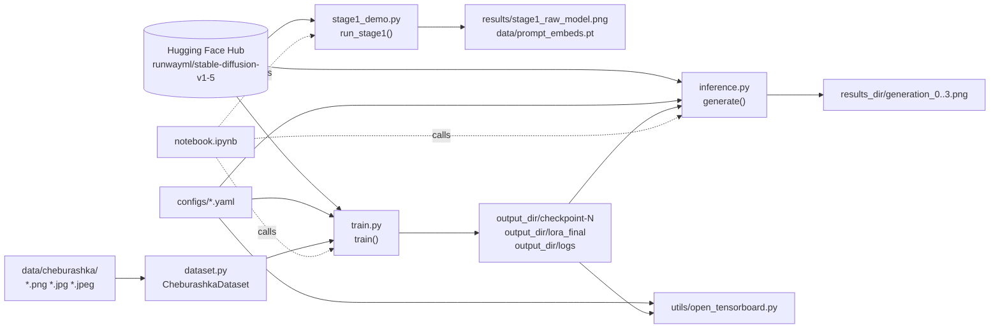

# lo-ra-fine-tuning: documentation hub

This repository fine-tunes Stable Diffusion v1.5 (`runwayml/stable-diffusion-v1-5`)
with LoRA adapters on the UNet so that the prompt token `<cheburashka>` produces the
character Cheburashka. It has three Python scripts: stage 1 shows what the base
model draws, stage 2 trains the adapters, and stage 3 generates images with them.
A notebook runs all three. The repository does not say who it is for (see
[SPEC.md, Open questions](../SPEC.md#9-open-questions)).

## Status

- Last change to the project's own code: 2026-04-10. Commit `12c2fd4` added the
  scripts, configs, `docs/workflow.md` and the notebook. Commit `6b2f41b` added a
  GitHub link to the notebook. Commit `8a42fd8` (2026-08-05) added the MIT licence.
  On 2026-11-08 commit `ff9c226` moved the PNG files to
  Git LFS without changing their content. Every later commit up to `62b7b11` (2026-11-08)
  changed tooling or the README only (`git log`).
- Tests: none for the project's code. `recipe.ps1 test` runs pytest over `.claude`
  only (`recipe.ps1:45-46`), and it collects no tests.
- CI: five Gitea workflows in `.gitea/workflows/` run on a `windows` runner. There is
  no `.github/` directory, so nothing runs on GitHub. Whether a Gitea runner has
  ever run them is not recorded here.
- Unfinished: three keys in the config file are never read, and a file that
  stage 1 writes is never used. Four of the nine committed result images are
  entirely black. See [Known limitations](#known-limitations-and-problems).

## Layout

| Path | What it is |
|---|---|
| `stage1_demo.py` | Stage 1: base-model image for one prompt, plus an encoded prompt saved to `data/prompt_embeds.pt` |
| `dataset.py` | `CheburashkaDataset`: loads images and applies resize, crop and normalisation |
| `train.py` | Stage 2: LoRA training loop with optional Min-SNR weighting, TensorBoard logging and checkpoints |
| `inference.py` | Stage 3: four fixed prompts through the base pipeline with the trained adapter |
| `utils/open_tensorboard.py` | Starts TensorBoard on `<output_dir>/logs` from `configs/train_config_v2.yaml` |
| `utils/visualization.py` | Matplotlib helpers `visualize_batch`, `show_results`, `save_image` |
| `configs/train_config.yaml` | First hyperparameter set (learning rate 2e-5, outputs `./checkpoints`, `./results`) |
| `configs/train_config_v2.yaml` | Second set, the scripts' default (learning rate 1e-4, outputs `./checkpoints_v2`, `./results_v2`) |
| `notebook.ipynb` | Runs stages 1-3 in order; its outputs are saved in the file |
| `results/`, `results_v2/` | Committed PNG outputs (Git LFS, `.gitattributes:9`) |
| `docs/workflow.md` | Training and inference data flow as two mermaid diagrams |

`data/`, `checkpoints/`, `checkpoints_v2/`, `*.pt` and `*.safetensors` are gitignored
(`.gitignore:31-38`). The training images and the trained adapters are not in the
repository.

## Architecture



- Stage 1 does not read a config. The model id, the prompt and the output paths are
  hard-coded (`stage1_demo.py:7,17,25,43`).
- Stage 2 loads the tokenizer, CLIP text encoder, VAE, UNet and DDPM scheduler from
  the model id (`train.py:29-33`). It freezes the VAE and the text encoder
  (`train.py:35-36`) and wraps the UNet with PEFT LoRA on `to_k`, `to_q`, `to_v` and
  `to_out.0` (`train.py:38-44`). The model learns to predict the added noise
  (`train.py:105`).
- Stage 3 loads `StableDiffusionPipeline` and applies `PeftModel.from_pretrained` to
  its UNet from `<output_dir>/lora_final` (`inference.py:16-24`).
- External services: the Hugging Face Hub, through `from_pretrained`. No other network
  access appears in the code.
- [workflow.md](workflow.md) shows the per-step tensor flow.

## Build and run

Prerequisites, as stated in `README.md:41-59`: the base weights (downloaded on first
use), your own images in `data/cheburashka/`, a CUDA GPU with about 10 GB of memory,
and Python with PyTorch, `diffusers`, `transformers`, `peft`, `accelerate`,
`torchvision`, `pyyaml` and `tensorboard`. The code also imports `tqdm`, `Pillow`,
`numpy` and `matplotlib` (`train.py:5`, `dataset.py:3`, `utils/visualization.py:1-4`).
No file pins a version (`README.md:59`). The notebook's kernel metadata records
Python 3.10.0 (`notebook.ipynb`, metadata).

Install: no requirements file or install command exists. `recipe.ps1` has no install
target (`recipe.ps1:16`).

Run from the repository root, because every path in the code and the configs is
relative to the current directory and `train.py:14` imports `dataset` from it.

```bash
python stage1_demo.py   # README.md:54
python train.py         # README.md:55
python inference.py     # README.md:56
```

Other entry points:

- `python dataset.py` prints the dataset length, keys, image shape and prompt (`dataset.py:47-53`).
- `python utils/open_tensorboard.py` starts TensorBoard (`utils/open_tensorboard.py:32-33`).

## Configuration

No script parses command-line arguments or environment variables. The only way to
choose a config is the `config_path` argument of `train()` and `generate()`, which
defaults to `configs/train_config_v2.yaml` (`train.py:16`, `inference.py:7`).
`run_stage1()` takes no config. `utils/open_tensorboard.py:7` always reads the v2
file.

| Key | v1 / v2 value | Read by | If absent |
|---|---|---|---|
| `model.pretrained_model_name_or_path` | `runwayml/stable-diffusion-v1-5` | `train.py:27`, `inference.py:12` | KeyError |
| `model.revision` | `null` | not read | - |
| `training.learning_rate` | `2.0e-05` / `1.0e-04` | `train.py:61` | KeyError |
| `training.max_train_steps` | 1000 | `train.py:69,73,78,80` | KeyError |
| `training.train_batch_size` | 1 | `train.py:55` | KeyError |
| `training.max_grad_norm` | 1.0 | `train.py:129` | KeyError |
| `training.lr_scheduler` | `constant` | `train.py:66` | KeyError |
| `training.lr_warmup_steps` | 0 | `train.py:68` | KeyError |
| `training.snr_gamma` | 5.0 | `train.py:107` | plain MSE loss |
| `training.lora_rank` | 128 (also used as `lora_alpha`) | `train.py:39-40` | KeyError |
| `training.checkpointing_steps` | 500 | `train.py:145` | KeyError |
| `training.seed` | 42 | not read | - |
| `training.gradient_accumulation_steps` | 1 | not read | - |
| `data.instance_data_dir` | `./data/cheburashka` | `train.py:48` | KeyError |
| `data.instance_prompt` | `<cheburashka> plushie` | `train.py:49` | KeyError |
| `data.resolution` | 512 | `train.py:50` | KeyError |
| `data.center_crop` | `true` (`false` gives a random crop) | `train.py:51`, `dataset.py:29` | KeyError |
| `inference.guidance_scale` | 7.5 | `inference.py:38` | 7.5 |
| `inference.num_inference_steps` | 30 | `inference.py:39` | 30 |
| `output.output_dir` | `./checkpoints` / `./checkpoints_v2` | `train.py:20`, `inference.py:13`, `utils/open_tensorboard.py:16` | KeyError (TensorBoard helper: `./checkpoints`) |
| `output.results_dir` | `./results` / `./results_v2` | `train.py:21`, `inference.py:35` | KeyError |

These values are fixed in code and have no config key: AdamW weight decay 1e-2
(`train.py:62`), LoRA init `gaussian` and target modules (`train.py:41-42`), the four
inference prompts (`inference.py:28-33`), and the stage 1 seed 42 and 30 steps
(`stage1_demo.py:21-22`).

## Usage

- Full run in the notebook: cell 2 calls `run_stage1()`, cell 4
  `train("configs/train_config_v2.yaml")`, and cell 6
  `generate("configs/train_config_v2.yaml")` followed by `show_results('results', '<cheburashka>')`
  (`notebook.ipynb`, 0-based cell indices).
- Training with the first config: call `train("configs/train_config.yaml")` and then
  `generate("configs/train_config.yaml")` from Python. Outputs go to `./checkpoints`
  and `./results` (`configs/train_config.yaml:30-32`).
- Checking the data before training: `python dataset.py` (`dataset.py:47-53`).
- Watching the loss: `python utils/open_tensorboard.py`. Scalars `Loss/train` and `LR`
  are written at every step (`train.py:138-139`).

The notebook's saved output for the v2 run records 25,509,888 trainable parameters of
885,030,852 (2.88 %). It also records 1000 steps in 5 min 24 s and checkpoints saved
at steps 500 and 1000 (`notebook.ipynb`, cell 4 output). The device was CUDA: cell 2
prints `Using device: cuda` in the same kernel, while `train.py` prints no device. The
GPU model is not recorded.

## Testing

There are no tests for `dataset.py`, `train.py`, `inference.py`, `stage1_demo.py` or
`utils/`. `README.md:63-65` says the scripts are not tested because they would have
to download the weights first. `.\recipe.ps1 test` runs pytest, `ruff check` and
`ruff format` over `.claude` only (`recipe.ps1:45-53`). Pytest's exit code 5 (no
tests collected) counts as a pass (`recipe.ps1:47-48`). The only record of the
pipeline working is the notebook's saved output.

## Known limitations and problems

- No dependency versions are pinned, and there is no requirements file (`README.md:59`).
  `accelerate` is listed in `README.md:50` but no file imports it.
- `training.seed`, `training.gradient_accumulation_steps` and `model.revision` are never
  read (no `.py` file references them). The comment at
  `configs/train_config_v2.yaml:16` says the seed makes noise patterns identical between
  runs, but neither training nor inference seeds anything. Only stage 1 uses a seed
  (`stage1_demo.py:21`).
- `stage1_demo.py:41-43` saves `data/prompt_embeds.pt` "for Stage 2", but `train.py`
  does not read it. Training encodes the prompt again at every step (`train.py:94-101`).
- Four committed PNGs (`results/generation_1.png`, `results/generation_2.png`,
  `results_v2/generation_2.png`, `results_v2/generation_3.png`) decode to 512 by 512
  RGB images in which every byte is zero, so they are entirely black. For the v2 run,
  the notebook output for prompts 3 and 4 says "Potential NSFW content was detected
  ... A black image will be returned instead". For `results/` no log exists, so the
  same cause there is an inference. `inference.py` does not detect this case and saves
  the black image under the usual name (`inference.py:43-48`).
- If `<output_dir>/lora_final` is missing, `inference.py:22-26` prints a message and
  generates with the base model. The output files carry the same names either way, so
  a results folder does not show whether the adapter was applied.
- The fourth prompt is spelled `riding a bycycle` (`inference.py:32`).
- Notebook cell 6 generates into `results_v2` but displays `results`. `show_results`
  takes the first four entries of an unsorted `os.listdir`. For `results/` that listing
  also contains `stage1_raw_model.png`, so which four are shown depends on the file
  system's order (`utils/visualization.py:35-40`). Cell 0 names
  `configs/train_config.yaml` as the hyperparameters file, while cells 4 and 6 use v2.
- `stage1_demo.py` ignores both configs and always writes to `./results`
  (`stage1_demo.py:24-25`).
- `visualize_batch` and `save_image` are not called anywhere.
- The dataset reads only `.png`, `.jpg` and `.jpeg` files and does not check whether
  any were found (`dataset.py:18-25`). Behaviour with an empty folder was not checked.
- The PNGs are stored in Git LFS (`.gitattributes:9`). The committed blobs are pointer
  files of 128-131 bytes (`git cat-file -s`), so a clone without Git LFS gets no images.
- `README.md:74` links the lab requirements at a local address that does not open for
  public readers.

## Repository tooling

The project states compliance with revision 4.0.0 of the lab requirements, with
exceptions R-02, R-09, R-13, R-41 and R-42 (`README.md:74`). Its hooks, Gitea workflows
and issue and pull request templates are the same files as in
[repo-quality-template](https://github.com/IGORSVOLOHOVS/repo-quality-template)
(branch `release`). Only what is specific to this repository is listed here.

- `recipe.ps1` metadata: `$Name = 'lo-ra-fine-tuning'`, `$Code = 'lrft'`,
  `$Version = '1.0.0'`, empty `$Needs`, `$Tools` and `$Provides`, and
  `$Reviewers = @('igors')` (`recipe.ps1:9-22`). There is no `$App`, `$Entry`,
  `$Console`, `$Include` or `$Imports`, because nothing is installed (`recipe.ps1:16`).
- Verbs that do something:
  - `test` sets `core.hooksPath` and runs pytest, `ruff check` and `ruff format` (in
    place) over `.claude` (`recipe.ps1:41-54`). Ruff must be version 0.16.1
    (`.claude/ruff.toml:2`).
  - `info` prints name, code, version and summary (`recipe.ps1:56-62`).
  - `clean` deletes `__pycache__`, `.pytest_cache` and `.ruff_cache` directories
    (`recipe.ps1:63-68`). `README.md:65-66` says every other verb prints
    `nothing to <verb>`, which is not true for `clean`.
  - `build`, `install`, `uninstall`, `run` and `publish` print `nothing to <verb>`
    (`recipe.ps1:69-73`).
- Deviations: `.claude/.env` is gitignored, and no key is ever committed (`CLAUDE.md:20-24`,
  `.gitignore:20-24`). History from before the template was adopted was not reworded
  or signed off (`CLAUDE.md:66-67`).

## Related documents

- [../README.md](../README.md): project overview and result images
- [../SPEC.md](../SPEC.md): requirements specification reverse-engineered from the code
- [workflow.md](workflow.md): training and inference diagrams
- [../CLAUDE.md](../CLAUDE.md): working rules for this repository
- [../configs/train_config_v2.yaml](../configs/train_config_v2.yaml), [../configs/train_config.yaml](../configs/train_config.yaml): hyperparameters with the author's reasoning in comments
- [../notebook.ipynb](../notebook.ipynb): the recorded run
- [../LICENSE](../LICENSE): MIT

## About this document

Written on 2026-11-18 from commit `62b7b11` (branch `docs/spec-and-docs`, based on
`origin/release`).

Commands run to check it:

- Git: `git ls-files`, `git log`, `git show --stat` for `12c2fd4`, `6b2f41b` and
  `ff9c226`, `git cat-file -s`, `git lfs ls-files`.
- `.\recipe.ps1 info` (exit 0) and `.\recipe.ps1 run` (printed `nothing to run`).
- `python -m pytest --collect-only -q -p no:cacheprovider .claude` (no tests collected, exit 5).
- Python's `ast` module parsed all six `.py` files without errors.
- An import check found that torch, diffusers, transformers, peft, torchvision,
  tensorboard and matplotlib are not installed on the documenting machine.
- The four 843-byte PNGs were decoded with `zlib`.
- The notebook's code cells and its text outputs were read; its images were not.

Not run: `stage1_demo.py`, `train.py`, `inference.py`, `dataset.py`,
`utils/open_tensorboard.py` and the notebook, because they need the weights, the data,
a GPU and packages that are not installed. `.\recipe.ps1 test` was not run because it
writes git config and reformats files. `.\recipe.ps1 clean` was not run because it
deletes files. No network calls were made.
